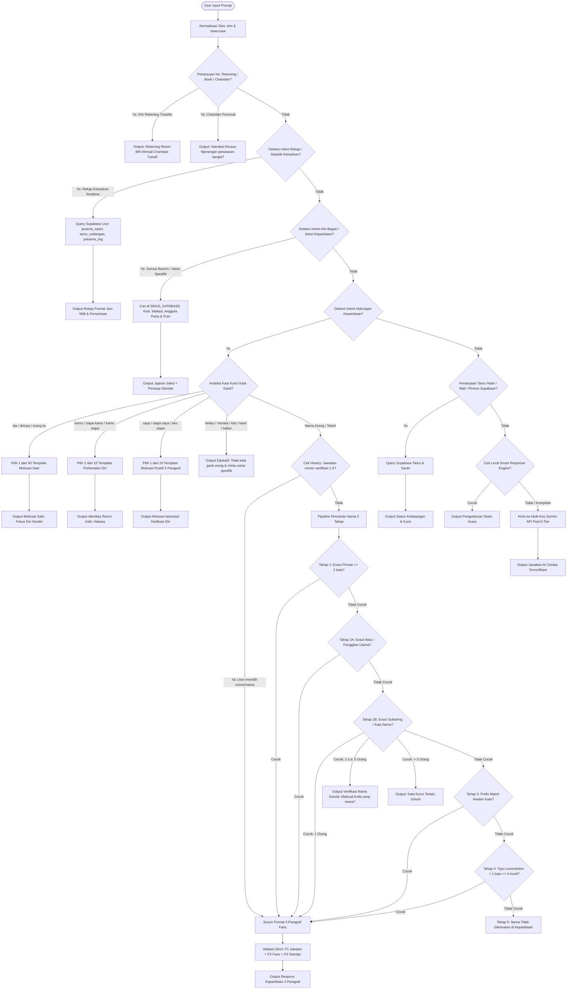

# DOKUMENTASI ALUR BERPIKIR (CHAIN OF THOUGHT) USTH. HALWAA AI ASSISTANT
**Haul & Haflah P3TQ & MHMTQ 1448 H. / 2027 M.**

Dokumentasi ini disusun secara transparan dan lengkap untuk membedah bagaimana **Usth. Halwaa** memproses setiap pertanyaan dari pengguna — mulai dari teks diketikkan di UI hingga respons akhir dikembalikan. Dokumen ini menjadi acuan utama bagi Developer dan User untuk melakukan **audit mandiri** dan **debugging** ketika terjadi anomali atau bug pada respons sistem.

---

## 1. DIAGRAM ALUR PROSES (ARCHITECTURE FLOWCHART)

Berikut diagram lengkap pohon keputusan logika *if/else* yang dieksekusi secara deterministik sebelum fallback ke model bahasa besar (LLM):

---

## 2. DETAIL SETIAP TAHAP (STEP-BY-STEP BREAKDOWN)

Berikut rincian setiap fungsi, berkas kode, input yang diharapkan, keluaran, serta kondisi penghentian (*early exit*):

| No | Tahap / Fitur | Berkas & Fungsi Penanggung Jawab | Contoh Input Pengguna | Output yang Dihasilkan | Kondisi Lanjut vs Berhenti |
|---|---|---|---|---|---|
| **1** | Normalisasi & Sanitasi Prompt | `app/api/ai/ask/route.ts` & helper fungsi | `"   Siapa Yazid??? "` | String bersih: `"siapa yazid"` | **Selalu lanjut** ke tahap berikutnya. |
| **2** | Deteksi Rekening & Chamdan | `route.ts` &rarr; `handleChamdanAndRekeningQuery` | `"minta no rek panitia"`, `"siapa ahmad chamdan"` | Detail Bank BRI / Respon humoris pancingan | **Berhenti** jika kata kunci rekening/chamdan terdeteksi. Lanjut jika tidak. |
| **3** | Deteksi Rekap Kehadiran Realtime | `lib/us-halwaa-rekap.ts` &rarr; `detectRekapKehadiranIntent` & `getLiveRekapKehadiran` | `"rekap kehadiran hari ini"`, `"sudah berapa hadir"` | Ringkasan realtime Jam WIB, data SH, Tamu Undangan, & Total Scan | **Berhenti** jika match pola rekap. Lanjut jika tidak cocok. |
| **4** | Deteksi Info Bagan / Seksi Kepanitiaan | `lib/us-halwaa-seksi.ts` &rarr; `detectInfoSeksiIntent` & `handleInfoSeksiQuery` | `"seksi keamanan"`, `"anggota desain grafis"`, `"sebutkan seluruh banom"` | Rincian Kasi, Wakasi, dan Anggota Putra & Putri | **Berhenti** jika terdeteksi intent seksi/banom. Lanjut jika bukan. |
| **5A** | Kata Ganti: "Dia" (Motivasi Satir) | `lib/us-halwaa-motivasi.ts` &rarr; `isThirdPersonPronounQuery` & `getRandomMotivasiSatirDia` | `"dia siapa"`, `"siapa dirinya"`, `"siapa dia sebenarnya"` | 1 paragraf sindiran satir agar fokus ke mimpi diri sendiri | **Berhenti** (Output deterministik langsung). |
| **5B** | Kata Ganti: "Kamu" (Perkenalan Diri) | `lib/us-halwaa-motivasi.ts` &rarr; `isKamuSiapaQuery` & `getRandomPerkenalanDiri` | `"kamu siapa"`, `"siapa kamu"`, `"kamu ai apa"` | Identitas resmi Usth. Halwaa asisten 24 jam kebanggaan Haflah | **Berhenti** (Output deterministik langsung). |
| **5C** | Kata Ganti: "Saya" (Motivasi Positif) | `lib/us-halwaa-motivasi.ts` &rarr; `isSayaSiapaQuery` & `getRandomMotivasiPositifSaya` | `"saya siapa"`, `"siapa saya"`, `"aku siapa"` | 2 paragraf motivasi mendalam penguat khidmah & apresiasi perjuangan | **Berhenti** (Output deterministik langsung). |
| **5D** | Kata Ganti Lain: ("Beliau", "Mereka", dll.) | `lib/us-halwaa-kepanitiaan.ts` &rarr; `isOtherPronounQuery` | `"siapa beliau"`, `"mereka siapa"`, `"siapa kalian"` | Pesan penolakan sopan meminta pengguna menyebut nama orang spesifik | **Berhenti** (Mencegah pencarian kata 'beliau' ke database). |
| **6A** | Pemilihan Verifikasi Duplikat | `lib/us-halwaa-kepanitiaan.ts` &rarr; `detectDuplicateSelectionIntent` | `"1"`, `"yang pertama"`, `"abu yazid"` (setelah verifikasi) | Memilih entitas panitia yang dimaksud dari riwayat chat | **Berhenti** langsung ke perakitan 3 paragraf. |
| **6B** | Ekstraksi Nama & Pencarian Tahap 1 (Exact Phrase) | `lib/us-halwaa-kepanitiaan.ts` &rarr; `findMatchedMembers` (Tahap 1) | `"ikfi ulit taufiqoh"` | Menemukan exact match multi-kata: **Ikfi Ulit Taufiqoh** | Jika cocok &rarr; **Berhenti** & rakit respons. Jika gagal &rarr; lanjut ke 2A. |
| **6C** | Pencarian Tahap 2A (Exact Alias / Panggilan) | `lib/us-halwaa-kepanitiaan.ts` &rarr; `findMatchedMembers` (Tahap 2A) | `"maulana"`, `"abha"` | Menemukan pemilik alias utama (Pak Maulana / Pak Abhaa) | Jika cocok &rarr; **Berhenti** & rakit respons. Jika gagal &rarr; lanjut ke 2B. |
| **6D** | Pencarian Tahap 2B (Exact Substring / Kata) | `lib/us-halwaa-kepanitiaan.ts` &rarr; `findMatchedMembers` (Tahap 2B) | `"yazid"`, `"sinta"`, `"asep"` | Menemukan 1 nama ATAU daftar 2-5 nama untuk diverifikasi | - 1 nama: Lanjut rakit respons. - 2-5: Kembalikan pilihan verifikasi. - > 5: Kembalikan peringatan terlalu umum. |
| **6E** | Pencarian Tahap 3 (Prefix Match Awalan Kata) | `lib/us-halwaa-kepanitiaan.ts` &rarr; `findMatchedMembers` (Tahap 3) | `"taufi"` (awalan dari Taufiq) | Menemukan anggota berawalan kata tersebut | Jika cocok &rarr; Lanjut rakit respons. Jika nihil &rarr; lanjut ke Tahap 4. |
| **6F** | Pencarian Tahap 4 (Typo Levenshtein = 1) | `lib/us-halwaa-kepanitiaan.ts` &rarr; `findMatchedMembers` (Tahap 4) | `"taufik"` &rarr; `Muhammad Taufiq` (beda k vs q) | Menemukan kandidat dengan jarak typo persis 1 huruf | Hanya berjalan jika token $\ge 4$ huruf dan 1 kata. Jika cocok &rarr; rakit respons. |
| **6G** | Pencarian Tahap 5 (Tidak Ditemukan) | `lib/us-halwaa-kepanitiaan.ts` | `"dina siapa"`, `"siapa zulkifli"` | `"Mohon maaf Us, nama Dina tidak ditemukan..."` | **Berhenti** dengan penutup standar. |
| **7** | Perakitan & Validasi 3 Paragraf Fans | `lib/us-halwaa-kepanitiaan.ts` &rarr; `generateHubunganResponseForMember` | Anggota panitia terpilih | Teks 3 paragraf: P1 (Jabatan), P2 (Fans), P3 (`Ada lagi info...`) | **Selesai** & dikirim ke UI. |
| **8** | Database Tamu/Santri Supabase Live | `route.ts` &rarr; `searchPersonInSupabase` | `"apakah bapak fulan sudah hadir"` | Informasi kehadiran, kode QR, dan kursi | **Berhenti** jika data tamu/wali ditemukan di Supabase. |
| **9** | Fallback Gemini LLM Pool | `route.ts` &rarr; `geminiPool` | Pertanyaan wawasan umum / fatwa / sejarah pesantren | Jawaban cerdas LLM berbasis prompt resmi USTH AL | **Berhenti**. |

---

## 3. PRIORITAS INTENT DETECTION (HIERARKI LOGIKA)

Urutan prioritas dieksekusi dari **paling atas ke paling bawah** di berkas [app/api/ai/ask/route.ts](file:///C:/Users/user/.gemini/antigravity/scratch/haflah-p3tq/app/api/ai/ask/route.ts):

1. **Rekening & Candaan Personal Ahmad Chamdan** (`handleChamdanAndRekeningQuery`):
   - Mencegah pertanyaan rekening tercegat oleh pencarian nama pribadi.
2. **Rekap Kehadiran Realtime** (`detectRekapKehadiranIntent`):
   - Mengambil data live presensi dari Supabase, bukan fuzzy nama orang.
3. **Info Bagan / Seksi Kepanitiaan** (`detectInfoSeksiIntent`):
   - Menyajikan informasi struktur seksi, Kasi/Wakasi, dan anggota banom.
4. **Hubungan Kepanitiaan & Identitas** (`detectHubunganKepanitiaanIntent`):
   - Sub-prioritas A: Kata ganti `"dia"` &rarr; Motivasi Satir.
   - Sub-prioritas B: Kata ganti `"kamu"` &rarr; Perkenalan Diri.
   - Sub-prioritas C: Kata ganti `"saya"` / `"aku"` &rarr; Motivasi Positif 2 Paragraf.
   - Sub-prioritas D: Kata ganti lain (`"beliau"`, `"mereka"`, dll.) &rarr; Penolakan edukatif.
   - Sub-prioritas E: Verifikasi nama ganda dari riwayat chat.
   - Sub-prioritas F: Pipeline Pencarian Nama (Tahap 1 &rarr; 2A &rarr; 2B &rarr; 3 &rarr; 4 &rarr; 5).
5. **Live Kehadiran Tamu / Santri Spesifik Supabase**:
   - Mengecek tabel `tamu_undangan` dan `peserta_santri`.
6. **Local Knowledge Engine (Fast Response Offline)**:
   - Menangani salam, ucapan terima kasih, dan pertanyaan statis umum.
7. **Gemini Generative AI API Pool (Multi-Tier Failover)**:
   - Tier 1: Gemini Pro Primary Key.
   - Tier 2: Rotasi Pool Kunci Alternatif Gemini 1.5 Flash / 2.0.
   - Fallback Terakhir: Local Smart Knowledge Offline.

---

## 4. SUMBER DATA (DATA SOURCES)

Berikut pemetaan asal data untuk setiap fitur di Usth. Halwaa:

| Kategori Fitur | Tipe Penyimpanan | Berkas Kode & Lokasi Sumber | Detail Struktur Data |
|---|---|---|---|
| **Hubungan Kepanitiaan (Personil)** | Hardcoded TypeScript Array | `lib/us-halwaa-kepanitiaan.ts` | 42 figur panitia (`name`, `aliases`, `jabatanTugas`, `displayTitle`). |
| **Template Fans / Hubungan** | Hardcoded TypeScript Object | `lib/us-halwaa-kepanitiaan.ts` | 50 template dalam 5 kategori gaya bahasa (10 template per kategori). |
| **Motivasi Satir ("Dia")** | Hardcoded TypeScript Array | `lib/us-halwaa-motivasi.ts` | 50 template kalimat sindiran produktif. |
| **Perkenalan Diri ("Kamu")** | Hardcoded TypeScript Array | `lib/us-halwaa-motivasi.ts` | 10 template identitas cerdas resmi Usth. Halwaa. |
| **Motivasi Positif ("Saya")** | Hardcoded TypeScript Array | `lib/us-halwaa-motivasi.ts` | 10 template motivasi 2 paragraf penguat semangat khidmah. |
| **Info Bagan & Seksi** | Hardcoded TypeScript Array | `lib/us-halwaa-seksi.ts` | 15 struktur seksi (`sekretariat`, `keamanan`, dll.) dengan Kasi/Wakasi/Anggota. |
| **Rekap Presensi Realtime** | Database PostgreSQL (Supabase) | `lib/us-halwaa-rekap.ts` & `lib/supabase.ts` | - Tabel `peserta_santri` (`kuota_terpakai`) - Tabel `tamu_undangan` (`status_konfirmasi`) - Tabel `presensi_log` (`kode_qr`, `tipe_peserta`) |
| **Pencarian Tamu/Santri Live** | Database PostgreSQL (Supabase) | `route.ts` &rarr; `searchPersonInSupabase` | Query tabel `peserta_santri` dan `tamu_undangan` secara real-time. |
| **Dokumen Kebijakan & Rundown** | System Prompt String | `route.ts` &rarr; `HAFLAH_KNOWLEDGE_SYSTEM_PROMPT` | Ekstraksi dokumen resmi *USTH AL.pdf* dan *HAFLAH-MATERI KOOR 2*. |

---

## 5. DAFTAR TEMPLATE & ATURAN ROTASI

### A. Rincian Jumlah Template
1. **Template Fans / Hubungan Kepanitiaan**: **50 Template**
   - Disimpan di: `lib/us-halwaa-kepanitiaan.ts` (`HUBUNGAN_KEPANITIAAN_TEMPLATES`)
   - 5 Kategori: `sopan_formal` (10), `hangat_ramah` (10), `santai_ekspresif` (10), `puitis_emosional` (10), `singkat_padat` (10).
2. **Template Motivasi Satir ("Dia")**: **50 Template**
   - Disimpan di: `lib/us-halwaa-motivasi.ts` (`MOTIVASI_SATIR_DIA_TEMPLATES`)
3. **Template Perkenalan Diri ("Kamu")**: **10 Template**
   - Disimpan di: `lib/us-halwaa-motivasi.ts` (`PERKENALAN_DIRI_TEMPLATES`)
4. **Template Motivasi Positif ("Saya")**: **10 Template**
   - Disimpan di: `lib/us-halwaa-motivasi.ts` (`MOTIVASI_POSITIF_SAYA_TEMPLATES`)

### B. Mekanisme Pemilihan (Anti-Repetisi)
- Template dipilih secara **acak (random)** dari kumpulan (*pool*).
- Sistem memelihara memori *ring-buffer* 5 riwayat terakhir (`last5HubunganTemplates`, `last5DiaSatirMotivasi`, `last5PerkenalanDiri`, `last5MotivasiPositifSaya`).
- Jika template pernah dipakai dalam 5 giliran terakhir, template tersebut dikecualikan dari pool pemilihan agar respons terdengar dinamis dan bervariasi.

### C. Jaminan Bebas Parafrase LLM
- Seluruh respons kepanitiaan, kata ganti, info seksi, dan rekap diselesaikan secara **100% deterministik di level kode TypeScript** sebelum mencapai panggilan Gemini API.
- Fungsi langsung me-return `NextResponse.json(...)` sehingga **LLM tidak memiliki akses untuk memparafrase atau mengubah kalimat template**.

---

## 6. TITIK RAWAN BUG & SOLUSI PENCEGAHAN (COMMON PITFALLS)

Berikut daftar potensi jebakan logika yang telah diproteksi di sistem:

1. **Typo Tolerance Terlalu Cepat (Levenshtein mendahului Exact Match)**:
   - *Kasus*: Query `"ikfi"` mencocokkan `"akfi"` (beda 1 huruf) sebelum sempat mengecek nama asli `"Ikfi Ulit Taufiqoh"`.
   - *Solusi*: Tahap 1, 2A, dan 2B dijalankan tuntas terlebih dahulu. Tahap 4 (Levenshtein) hanya aktif jika Tahap 1-3 sama sekali tidak menghasilkan kecocokan.
2. **Nama Panggilan vs Nama Panjang (Alias Matching)**:
   - *Kasus*: Query `"maulana"` memicu 3 orang karena ada 3 nama yang mengandung kata "Maulana" (Muhammad Abdurrohman Maulana, Gama Maulana Ilham, Adiva Maulana).
   - *Solusi*: **Tahap 2A (Exact Alias Match)** memprioritaskan personil yang memang memiliki alias primer `maulana` (Pak Maulana) sebelum substring multi-kata di Tahap 2B.
3. **Kata Ganti Orang Dianggap Nama Panitia**:
   - *Kasus*: Pertanyaan `"siapa saya?"` mencari kata `"saya"` di database dan mencocokkan panitia yang namanya mengandung huruf tersebut.
   - *Solusi*: Deteksi kata ganti orang dieksekusi di gerbang awal sebelum fungsi pencarian database berjalan.
4. **Penimpaan Kalimat Penutup oleh Helper Sesi**:
   - *Kasus*: Helper sesi `cleanReplyForSession` menimpa penutup menjadi bahasa Jawa (*"Wonten ingkang saget dibantu Us?"*).
   - *Solusi*: Respons kepanitiaan membypass penggantian otomatis ini dan mengunci penutup resmi: `"Ada lagi info kepanitiaan yang bisa saya bantu, Us?"`.
5. **Inkonsistensi Panggilan Nama Antar Paragraf**:
   - *Kasus*: Di Paragraf 1 disebut "Pak Akfi", di Paragraf 2 disebut "Pak Yazid".
   - *Solusi*: Fungsi `generateHubunganResponseForMember` melakukan *replacement regex* menyeluruh pada placeholder nama dan kata `beliau` menjadi `callName` yang konsisten.
6. **Validasi Mutlak 3 Paragraf di Level Kode**:
   - Sebelum teks di-return, dilakukan validasi:
     1. Paragraf 1 berisi nama tebal `**Nama Lengkap**` dan jabatan.
     2. Paragraf 2 wajib lolos regex sanjungan/fans (`/penggemar|fans|kagum|mengidolakan|nge-fans|mendampingi|ikut/i`).
     3. Paragraf 3 wajib persis `"Ada lagi info kepanitiaan yang bisa saya bantu, Us?"`.

---

## 7. ALUR FALLBACK & PENANGANAN KESALAHAN (ERROR HANDLING)

1. **Jika Supabase Mengalami Timeout / Putus Jaringan**:
   - Modul `lib/us-halwaa-rekap.ts` dilengkapi blok `try-catch`. Jika koneksi database putus, sistem tidak akan crash (500), melainkan mengembalikan data fallback aman dengan jumlah kuota dasar resmi (536 Shohibul Hajat & 1.534 Tamu Undangan).
2. **Jika Semua Kunci Gemini Mengalami Rate Limit (429) atau Error (500)**:
   - Modul `geminiPool` akan menandai kunci yang gagal untuk *cooldown* selama 30-60 detik dan mencoba kandidat kunci/model berikutnya.
   - Jika seluruh pool kunci Gemini habis, sistem secara otomatis mengeksekusi `generateLocalSmartResponseAsync` (Local Knowledge Engine Offline) sehingga pengguna tetap mendapatkan jawaban faktual.
3. **Jika Array Template Tidak Tersedia**:
   - Pool pemilihan memiliki mekanisme fallback ke seluruh array asli jika filter riwayat bernilai kosong.
4. **Log Error & Monitoring**:
   - Setiap kegagalan fatal ditangkap di blok *try-catch* `POST` utama dan mengembalikan status JSON `{ error: ... }` dengan kode HTTP yang sesuai, serta dicatat di log server.

---

## 8. CARA MENGGUNAKAN MODE DEBUGGING MANDIRI

Untuk memudahkan audit di lingkungan web browser:
1. Buka aplikasi web dengan parameter `?debug=1` di URL (contoh: `http://localhost:3000/admin/dasbor?debug=1`).
2. Buka **Developer Tools** di browser (tekan `F12` atau `Ctrl + Shift + I`) dan pilih tab **Console**.
3. Kirimkan pertanyaan di modal chat Usth. Halwaa.
4. Perhatikan log terstruktur berawalan `[Halwaa Debug]` yang menampilkan:
   - Input Query asli.
   - Intent yang terdeteksi.
   - Sumber engine (`source` dan `model`).
   - Panjang karakter dan durasi respons.
