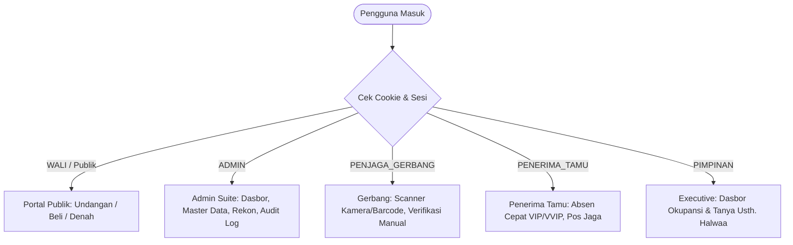
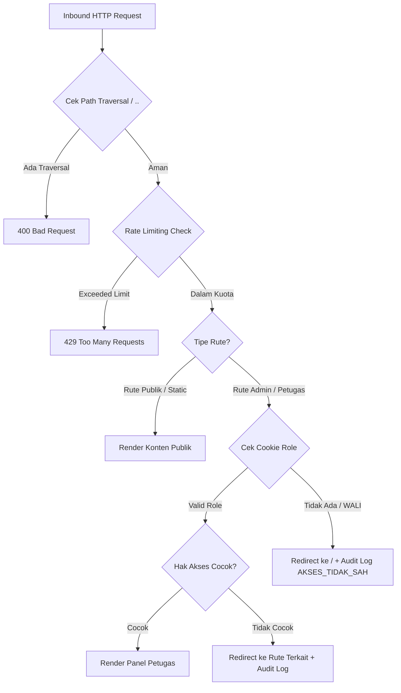

# PRODUCT REQUIREMENTS DOCUMENT (PRD)
## SISTEM MANAJEMEN PRESENSI, UNDANGAN DIGITAL & ASISTEN AI
### HAUL & HAFLAH AKHIRUSSANAH P3TQ & MHMTQ LIRBOYO 1448 H. / 2027 M.

---

| Dokumen | Keterangan |
|---|---|
| **Versi Produk** | v4.2.0 (Stable Release) |
| **Status** | Approved & Implemented |
| **Platform** | Web & Progressive Web App (Next.js 14 App Router, React 18, Tailwind CSS, Supabase PostgreSQL) |
| **Domain Resmi** | `https://haflahp3tq.site` |
| **Target Acara** | Sabtu, 24 Rajab 1448 H. / 02 Januari 2027 M. |
| **Lokasi Fisik** | Aula Al-Muktamar Pondok Pesantren Lirboyo Kediri |

---

## 1. RINGKASAN EKSEKUTIF & LATAR BELAKANG

Pondok Pesantren Putri Tahfizhil Qur-an (P3TQ) dan Madrasah Hidayatul Mubtadi-aat Fittahfizhi wal Qiro-at (MHMTQ) Lirboyo Kediri menyelenggarakan agenda akbar tahunan **Haul & Haflah Akhirussanah**. Acara ini melibatkan ribuan jamaah, meliputi wali santri wisudawati (Takhtiman Bil Ghoib, Bin Nadzori, dan Tamatan Aliyah) serta tamu undangan lintas tingkatan (Masyayikh, Habaib, Pejabat Pemerintahan, Asatidz, dan Alumni).

Tantangan utama operasional meliputi:
1. **Antrean Gerbang & Titik Kemacetan**: Proses registrasi manual berisiko memperlambat pergerakan ribuan tamu di Gerbang Bola Dunia.
2. **Kesesuaian Hak Akses & Kursi (Kuota)**: Pengendalian kapasitas kursi Aula Al-Muktamar dan segregasi jenis tiket fisik (Hitam Gold vs Merah Gold).
3. **Privasi & Keamanan Informasi**: Perlindungan data nomor telepon dan alamat santri dari konsumsi publik tanpa otorisasi.
4. **Layanan Informasi Terpadu (FAQ & Adicara)**: Kebutuhan panduan instan seputar tata tertib, denah lokasi, jadwal, dan susunan kepanitiaan tanpa membebani panitia secara fisik.

Untuk menjawab kebutuhan ini, dibangun platform terpadu yang memadukan **Undangan Digital Berbasis HMAC QR**, **Scanner PWA Realtime**, **Panel Kontrol Otoritas Berjenjang (RBAC)**, dan **Asisten Virtual Cerdas Usth. Halwaa AI**.

---

## 2. PENGGUNA & PERAN SISTEM (USER PERSONAS & RBAC)

Sistem menerapkan prinsip **Role-Based Access Control (RBAC)** berbasis sesi dan cookie yang diproteksi di lapisan Edge Middleware dan Client Guard:

### Matriks Hak Akses (Role Permissions Matrix)

| Modul / Rute | WALI (Publik) | PENJAGA_GERBANG | PENERIMA_TAMU | PIMPINAN | ADMIN |
|---|:---:|:---:|:---:|:---:|:---:|
| **Portal Undangan (`/u/[token]`)** | ✅ | ✅ | ✅ | ✅ | ✅ |
| **Beli Kuota Mandiri (`/beli/[token]`)** | ✅ | ❌ | ❌ | ❌ | ✅ |
| **Denah Interaktif (`/denah`)** | ✅ | ✅ | ✅ | ✅ | ✅ |
| **Scanner Gerbang (`/scan`)** | ❌ | ✅ | ❌ | ❌ | ✅ |
| **Verifikasi Manual (`/admin/verifikasi`)** | ❌ | ✅ | ❌ | ❌ | ✅ |
| **Panel Penerima Tamu (`/penerima-tamu`)** | ❌ | ✅ | ✅ | ❌ | ✅ |
| **Live Dasbor Kehadiran (`/dasbor`, `/admin/dasbor`)**| ❌ | ✅ | ✅ | ✅ | ✅ |
| **Eksekutif View (`/pimpinan`)** | ❌ | ❌ | ❌ | ✅ | ✅ |
| **Master Peserta & Tamu (`/admin/peserta`)** | ❌ | ❌ | ❌ | ❌ | ✅ |
| **Rekonsiliasi Kuota (`/rekon`)** | ❌ | ❌ | ❌ | ❌ | ✅ |
| **Audit Log System (`/admin/audit-log`)** | ❌ | ❌ | ❌ | ❌ | ✅ |
| **WhatsApp Gateway (`/admin/whatsapp`)** | ❌ | ❌ | ❌ | ❌ | ✅ |

---

## 3. SPESIFIKASI FITUR FUNGSIONAL

### 3.1. Portal Undangan Digital Wali Santri & Tamu (`/u/[token]`)
- **Sanitasi Parameter Token**: Parameter URL divalidasi dengan regex ketat `^[A-Za-z0-9_-]+$`. Parameter manipulatif atau path traversal (`..`, `%2e%2e`) ditolak seketika.
- **Peniadaan Fallback Statis**: Jika kode tidak terdaftar di database Supabase atau mock data lokal, sistem merender tampilan **404 Undangan Santun** mandiri tanpa menampilkan data dummy (seperti `SH0001`) dan tanpa merender navigasi admin.
- **Kartu QR Terenkripsi**: QR Code membawa payload terverifikasi SHA-256 HMAC untuk verifikasi integritas saat di-scan oleh panitia.
- **RSVP Kehadiran Mandiri**:
  - Wali Santri: Menginput estimasi jumlah pria (L) dan wanita (P) dengan batasan total $\le$ kuota dasar + kuota tambahan.
  - Tamu Undangan: Konfirmasi 2-opsi ("HADIR" / "BERHALANGAN").
- **Backsound Tradisional & Interaksi**: Pemutar audio instrumental dengan kontrol floating toggle yang ramah kebijakan autoplay peramban modern.

### 3.2. Operasional Gerbang & Presensi Cepat (`/scan` & `/admin/verifikasi`)
- **PWA Scanner Multi-Input**:
  - Pemindaian kamera perangkat (ZXing Engine) dengan rasio pandang responsif `aspect-video`.
  - Dukungan USB/Bluetooth Barcode Hardware Scanner (Keyboard Emulation).
- **Indikator Golongan Tiket**:
  - **Hitam Gold**: Khusus Wali Santri Takhtiman Bil Ghoib (Maju Panggung Utama).
  - **Merah Gold**: Tamu Undangan Umum & Shohibul Hajat Reguler.
- **Pencegahan Double-Checkin**: Kuota terpakai dikunci per pemindaian. Apabila kuota telah habis, sistem membunyikan buzzer error dan memunculkan modal peringatan kuota penuh.

### 3.3. Asisten Virtual Cerdas: Usth. Halwaa AI (`/api/ai/ask`)
Usth. Halwaa bertindak sebagai pemandu resmi dengan arsitektur multi-layer:
1. **Motivasi Satir & Humor Cerdas**:
   - Menangani query kata ganti pihak ketiga ("siapa dia", "siapa beliau") dengan 50 template motivasi satir khas kepanitiaan santri tanpa sapaan formal.
   - Menangani query personal Chamdan / Hamdan dengan tahapan dialog interaktif (Stage 1: *"Njenengan penasaran sanget?"* $\rightarrow$ Stage 2: Gurauan nomor rekening).
2. **Pencarian Nama Personil Kepanitiaan**:
   - Sinkronisasi otomatis (*auto-sync*) 191 personil dari susunan seksi ke struktur data relasional.
   - Toleransi typo, pengabaian gelar/panggilan (Pak, Bu, Gus, Ning, Ust, Mas, Kang, Mbak), dan normalisasi apostrof (contoh: "Sa'dun" vs "Sadun").
   - Deteksi stop-words bahasa Jawa (contoh: *"Reza niku sinten?"* $\rightarrow$ langsung memetakan ke nama personil Reza).
   - Format jawaban standar 3 paragraf: Jabatan resmi $\rightarrow$ Pujian humoris $\rightarrow$ Penutup *"Ada lagi info kepanitiaan yang bisa saya bantu, Us?"*.
3. **Data Kehadiran Realtime (Live Database)**:
   - Menjawab statistik presensi secara dinamis dari tabel Supabase `peserta_santri` dan `tamu_undangan`.
   - Melampirkan payload chart interaktif (*Dual-Pie Chart: Wali vs Tamu*) jika pengguna meminta visualisasi grafik.
   - Peniadaan angka hardcoded (seperti 536 atau 1.534) demi integritas data langsung.

### 3.4. Denah Interaktif Aula Al-Muktamar (`/denah` & Component Modal)
- **Gesture Pan & Zoom**: Navigasi kanvas SVG/HTML dengan dukungan mouse-wheel, pinch-to-zoom (skala 0.5x hingga 3.0x), serta tombol kontrol (+, -, reset).
- **Zonasi Khusus**: Peta digital memvisualisasikan Panggung Kehormatan, Area Undangan VVIP/VIP, Kursi Wali Santri Bil Ghoib, Kursi Tamatan Aliyah, Jalur Peladen, Pos Medis, dan Prasmanan Dzurriyah.

---

## 4. KEAMANAN & ISOLASI SISTEM (SECURITY ARCHITECTURE)

### 4.1. Pencegahan Kebocoran Layout (Layout Isolation)
- **Isolasi Total AppShell**: [`AppShell.tsx`](file:///C:/Users/user/.gemini/antigravity/scratch/haflah-p3tq/components/AppShell.tsx) secara eksplisit memeriksa `isAdminRoute` (`/admin`, `/scan`, `/rekon`, `/dasbor`). Rute di luar whitelist tersebut (termasuk `/u`, `/u/[token]`, `/denah`, dan halaman 404) dirender sebagai kontainer publik polos tanpa memanggil komponen `<Sidebar />` dan `<TopHeader />`.
- **Halaman 404 Khusus**: Root [`app/not-found.tsx`](file:///C:/Users/user/.gemini/antigravity/scratch/haflah-p3tq/app/not-found.tsx) dibangun mandiri dengan logo Haul & Haflah Gold dan tombol navigasi beranda tanpa elemen navigasi internal panitia.

### 4.2. Edge Middleware Protection
- **Path Traversal Shield**: Middleware memeriksa URL mentah dan decodeURIComponent. Pola `..` dan `%2e%2e` langsung diblokir dengan status HTTP `400 Bad Request`.
- **Sliding-Window Rate Limiting**:
  - Rute Publik & API: Dibatasi maksimal 60 permintaan/menit per alamat IP.
  - Rute Admin: Dibatasi maksimal 200 permintaan/menit per alamat IP.
  - Pelanggaran kuota menghasilkan respons HTTP `429 Too Many Requests` disertai header `Retry-After: 60`.
- **Audit Logging Akses Ilegal**: Upaya pembobolan atau akses URL rahasia oleh peran non-admin langsung disisipkan secara asinkron ke tabel Supabase `audit_log` dengan label `AKSES_TIDAK_SAH`.

---

## 5. SKEMA DATA & INTEGRASI (DATABASE SCHEMA)

Platform terintegrasi langsung dengan database PostgreSQL Supabase dengan tabel-tabel utama:

1. **`peserta_santri`**:
   - `id`, `kode` (PK / Unique, contoh: `SH001`), `nama`, `nama_wali`, `alamat`, `no_hp`
   - `kategori_utama` (`BIL_GHOIB` | `BIN_NADZORI` | `ALIYAH`), `sub_kategori`, `kelas`, `kamar`
   - `kuota_dasar`, `kuota_tambahan`, `kuota_terpakai`
   - `status_konfirmasi` (`BELUM` | `SUDAH`), `perkiraan_l`, `perkiraan_p`, `catatan_konfirmasi`
   - `warna_tiket` (`HITAM_GOLD` | `MERAH_GOLD`)
2. **`tamu_undangan`**:
   - `id`, `kode` (PK / Unique, contoh: `UND001`), `nama`, `nama_putra`, `nama_putri`
   - `kategori` (`VVIP` | `VIP` | `IDS` | `KEHORMATAN` | `PENGUJI` | `ASATIDZ` | `PERWAKILAN`)
   - `instansi`, `alamat`, `no_hp`, `kuota_dasar`, `kuota_terpakai`
   - `status_konfirmasi` (`BELUM` | `HADIR` | `BERHALANGAN`)
3. **`presensi_log`**:
   - `id`, `kode_qr`, `nama_peserta`, `kategori`, `jumlah_l`, `jumlah_p`, `petugas_pintu`, `jalur`, `created_at`
4. **`pembelian_kuota`**:
   - `id`, `kode_santri`, `nama_wali`, `jumlah_kursi`, `nominal`, `bukti_transfer_url`, `status` (`MENUNGGU` | `DIVERIFIKASI` | `DITOLAK`)
5. **`konfigurasi_sistem`**:
   - Pengaturan global: status switch buka/tutup pembelian kuota tambahan, nomor WhatsApp CS panitia, dan pagu kursi.
6. **`audit_log`**:
   - Pencatatan seluruh transaksi administratif (tambah peserta, edit kuota, pembatalan presensi, dan insiden akses ilegal).

---

## 6. METRIK KEBERHASILAN (SUCCESS CRITERIA & KPI)

1. **Kecepatan Transaksi Gerbang**: Waktu scan hingga validasi tiket rata-rata $\le 800\text{ ms}$ per tamu.
2. **Keandalan Akses**: Ketersediaan (*availability*) sistem $99.9\%$ selama hari pelaksanaan acara.
3. **Zero Data Leak**: 0 kebocoran komponen sidebar/admin header pada halaman tamu dan halaman 404.
4. **Akurasi Asisten Usth. Halwaa**: Skor kelulusan test suite kepanitiaan dan rekap presensi $100\%$ (36/36 skenario lulus).
5. **Integritas Kuota**: Selisih antara jumlah kursi fisik Aula Al-Muktamar dan total kuota tersistem adalah 0 kursi.

---

## 7. RENCANA PENGEMBANGAN BERIKUTNYA (FUTURE ROADMAP)

- **Fase 1 (Selesai)**: Core system, PWA Scanner, Denah Interaktif, Asisten Usth. Halwaa AI, Isolasi Keamanan Layout & RBAC.
- **Fase 2 (Gladi Kotor & Bersih - Des 2026)**: Uji beban konkurensi 1.000 request/detik, sinkronisasi offline-first PWA lokal bila koneksi seluler terganggu di area gedung.
- **Fase 3 (Hari-H - Jan 2027)**: Live TV Wallboard di 8 Pos Jaga dan siaran progres kehadiran berkala ke kanal panitia.
